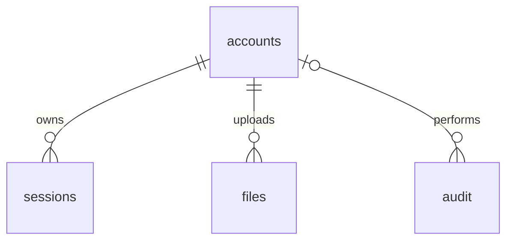

# เอกสารส่งต่องานฐานข้อมูล GECC Sisaket 2570

ตรวจจาก implementation ในเครื่อง วันที่ 28 ตุลาคม 2569 (2026-10-28)
เอกสารนี้อธิบายสคริปต์ที่มีจริง ไม่ได้ยืนยันว่าตารางถูกสร้างบนเซิร์ฟเวอร์หน่วยงานแล้ว

## 1. มีสคริปต์พร้อมใช้อยู่แล้ว

- `server/schema.sql`: DDL สร้างตาราง 5 ตารางและดัชนี
- `server/manage.js migrate`: เรียก DDL แล้วเพิ่มข้อมูลตั้งต้นเมื่อยังไม่มี app_state
- `server/seed.js`: เตรียมรายชื่อ 28 หน่วยบริการ 6 กลุ่ม รหัส GECC ภายใน 000001–000028 และเนื้อหาสาธารณะเดิม
- `server/store.js`: PostgreSQL connection, transaction, การอ่าน state และการเพิ่ม audit

ใช้ PostgreSQL ตามสถาปัตยกรรมปัจจุบัน ฐานข้อมูล/DB user ต้องถูกสร้างโดยผู้ดูแลก่อน
สคริปต์นี้ไม่สร้าง database, database role หรือให้สิทธิ์ระดับเซิร์ฟเวอร์

## 2. ตารางจริงและคอลัมน์

### app_state — ข้อมูลธุรกิจที่คงรูปแบบระบบเดิม

| คอลัมน์ | ชนิด | หน้าที่ |
|---|---|---|
| id | integer, PK, CHECK id=1 | แถวข้อมูลหลักเพียงแถวเดียว |
| revision | integer, NOT NULL, default 1 | เลขรุ่นข้อมูลสำหรับป้องกันการบันทึกชนกัน |
| document | jsonb, NOT NULL | รายชื่อหน่วยบริการ กลุ่ม แบบประเมิน ข้อบกพร่อง และค่าตั้งระบบ |
| updated_at | timestamptz, default now() | เวลาปรับปรุงข้อมูล |

ระบบอ่านแถวนี้ด้วย FOR UPDATE ใน transaction ก่อนแก้ไข และเปรียบเทียบ revision
การแก้คนละหน่วยบริการพร้อมกันก็อาจเกิด revision conflict ได้ เพราะใช้ revision ระดับระบบ

### accounts — บัญชีผู้ใช้และขอบเขตสิทธิ์

| คอลัมน์ | ชนิด | หน้าที่ |
|---|---|---|
| id | text, PK | ID บัญชี สร้างจาก UUID ใน application |
| username | text, UNIQUE, NOT NULL | ชื่อเข้าสู่ระบบ; บัญชีหน่วยบริการใช้รหัส GECC 6 หลัก |
| name | text, NOT NULL | ชื่อแสดงผล |
| password_hash | text, NOT NULL | hash แบบ scrypt ไม่เก็บรหัสผ่านจริง |
| role | text, CHECK | mentee / mentor / coord |
| unit_id | text, nullable | ID หน่วยบริการสำหรับ mentee เช่น u01 |
| team | integer, nullable | กลุ่มที่มอบหมายให้ mentor |
| active | boolean, default true | เปิด/ปิดบัญชี |
| must_change | boolean, default true | ต้องเปลี่ยนรหัสผ่านครั้งแรก/หลัง reset |
| created_at | timestamptz, default now() | วันสร้างบัญชี |

CHECK ปัจจุบันบังคับให้ mentee มี unit_id และ mentor มี team ส่วน coord เข้าถึงได้ทุกกลุ่ม
รหัสหน่วยบริการ 6 หลักเป็น username/code; ไม่ใช่รหัสผ่าน และไม่ใช่ accounts.id

### sessions — การเข้าสู่ระบบ

| คอลัมน์ | ชนิด | หน้าที่ |
|---|---|---|
| token_hash | text, PK | SHA-256 ของ session token ไม่เก็บ token cookie ตรง ๆ |
| account_id | text, FK -> accounts.id, NOT NULL | เจ้าของ session |
| csrf | text, NOT NULL | ค่าสำหรับตรวจ CSRF |
| expires_at | timestamptz, NOT NULL | เวลาหมดอายุ |

Session ปัจจุบันมีอายุ 8 ชั่วโมง การเปลี่ยน/reset รหัสผ่านหรือปิดบัญชียกเลิก session ตามคำสั่ง API

### files — ทะเบียนไฟล์แนบ

| คอลัมน์ | ชนิด | หน้าที่ |
|---|---|---|
| id | text, PK | ID อ้างอิงไฟล์และชื่อไฟล์ใน private storage |
| unit_id | text, NOT NULL | หน่วยบริการเจ้าของข้อมูล |
| account_id | text, FK -> accounts.id, NOT NULL | ผู้ upload/บัญชีที่นำเข้า |
| name | text, NOT NULL | ชื่อไฟล์ที่แสดง |
| mime | text, NOT NULL | ประเภทไฟล์ |
| size | integer, CHECK >0 | ขนาดเป็น byte |
| digest | text, NOT NULL | SHA-256 ของ binary |
| created_at | timestamptz, default now() | เวลาเพิ่มไฟล์ |

มี index files_unit(unit_id) ตัว binary อยู่นอก public web root ใน FILE_ROOT
ไม่ได้เก็บ binary ในตารางนี้ และเอกสารใน Google Drive Library ยังคงเป็นลิงก์ภายนอก
จึงต้องสำรองทั้งฐานข้อมูลและพื้นที่ไฟล์ ไม่ใช่ dump ฐานข้อมูลอย่างเดียว

### audit — ประวัติการทำรายการ

| คอลัมน์ | ชนิด | หน้าที่ |
|---|---|---|
| id | text, PK | ID เหตุการณ์ |
| account_id | text, FK -> accounts.id, nullable | ผู้กระทำ |
| action | text, NOT NULL | login/save/upload/review/return/reopen/import ฯลฯ |
| resource | text, NOT NULL | รายการเป้าหมาย เช่น state, unit ID หรือ file ID |
| revision | integer, nullable | รุ่นข้อมูลที่เกี่ยวข้อง |
| created_at | timestamptz, default now() | เวลาเหตุการณ์ |

มี index audit_created(created_at) Application เพิ่มเหตุการณ์แบบ append-only
แต่ SQL ยังไม่มี trigger/สิทธิ์ DB ที่ห้ามเจ้าของฐานข้อมูลแก้หรือลบ audit
จึงไม่ใช่หลักฐานแบบ tamper-proof และไม่ได้เก็บ full before/after snapshot ทุกเหตุการณ์

## 3. ความสัมพันธ์จริงและข้อจำกัด



`accounts.unit_id`, `accounts.team` และ `files.unit_id` ยังไม่มี foreign key ไปยัง
ตารางหน่วยบริการ/กลุ่ม เพราะหน่วยบริการและกลุ่มยังอยู่ใน document JSONB
API ตรวจการอ้างอิงและสิทธิ์เหล่านี้ การรัน SQL โดยตรงจึงต้องรักษากฎเองด้วย

FK ที่มีอยู่ใช้พฤติกรรมปกติของ PostgreSQL (ไม่ได้กำหนด ON DELETE CASCADE)
ระบบจึงปิดบัญชีด้วย active=false แทนการลบบัญชีที่มีประวัติ/ไฟล์อ้างอิง

## 4. หัวเรื่องข้อมูลที่อยู่ใน JSONB ขณะนี้

| JSON path | เนื้อหา |
|---|---|
| units[] | ID หน่วยบริการ รหัส GECC 6 หลัก ชื่อ อำเภอ กลุ่ม ประเภทการสมัคร |
| teams[] | กลุ่ม MENTOR หัวหน้ากลุ่ม สมาชิก และภาพกลุ่ม |
| assess[unitId] | แบบประเมินปัจจุบันของแต่ละหน่วยบริการ |
| assess[unitId].phys | เกณฑ์กายภาพ 15 ข้อ |
| assess[unitId].qc | Checklist และคะแนนคุณภาพ |
| assess[unitId].narr | คำบรรยาย ลิงก์หลักฐาน และคะแนน |
| assess[unitId].out | ผลลัพธ์และองค์ประกอบคะแนน |
| assess[unitId].ready | แบบประเมินความพร้อมและการตรวจยืนยัน |
| assess[unitId].survey | ความพึงพอใจ/ความเชื่อมั่น |
| assess[unitId].ev / rev / adv | หลักฐานอ้างอิง ความเห็นรายข้อ และคำแนะนำ |
| assess[unitId].quick | เอกสารส่งด่วน |
| assess[unitId].wf / wf.log | สถานะส่ง/ตรวจ/คืน/ล็อก และประวัติ workflow |
| defects[] | ข้อบกพร่อง คำตอบ การติดตาม และประวัติสถานะ |
| cal | วันในปฏิทินการสมัคร |
| publicContent | Library คณะทำงาน ภาพ และอำนาจหน้าที่ |
| mentorCoordinators[] | ข้อมูลผู้ประสานงานที่เผยแพร่ |
| nextUnitCode / retiredUnitIds | ออกรหัสใหม่และป้องกันใช้ ID ที่ยกเลิกซ้ำ |

นี่คือโครงสร้างแบบผสมเพื่อเชื่อมเว็บเดิมโดยไม่เขียนสูตรคะแนนใหม่ ไม่ใช่ฐานข้อมูลที่ normalize ทุกเรื่องแล้ว
app_state ไม่ใช่ event history และ assess[unitId] ไม่ได้แยกผลแต่ละปี/รอบเป็นคนละแถว

## 5. ถ้าทีมผู้เชี่ยวชาญต้องการแยกตารางธุรกิจ

หัวเรื่องต่อไปนี้เป็นข้อเสนอสำหรับออกแบบรุ่น relational เพิ่มเติม **ยังไม่มีอยู่ใน schema.sql**:

| กลุ่มตารางที่ควรออกแบบ | ประเด็นที่ต้องกำหนด |
|---|---|
| organizations | ID ถาวร, code 6 หลัก, อำเภอ, สถานะหน่วยบริการ |
| mentor_teams / team_members | กลุ่ม สมาชิก และการมอบหมายงาน |
| assessment_cycles / assessments | ปีงบประมาณ หน่วยบริการ รอบ และสถานะ |
| criteria_versions / criteria_items | เกณฑ์ตามปี เวอร์ชัน และคะแนนเต็ม |
| assessment_answers | คำตอบ/คะแนนต่อเกณฑ์ อ้างอิง assessment และ criterion |
| readiness_assessments | แบบประเมินความพร้อมและผู้ตรวจยืนยัน |
| survey_results | ช่วงสำรวจ จำนวนผู้ตอบ และคะแนนแต่ละหัวข้อ |
| evidence_links | เชื่อม file กับแบบประเมิน/เกณฑ์/ผู้ส่ง โดยไม่ปะปนกับ Google Drive Library |
| review_comments | ความเห็นรายข้อและคำแนะนำ |
| defects / defect_events | ข้อบกพร่อง คำตอบ และการเปลี่ยนสถานะ |
| workflow_events | ส่งตรวจ ตรวจแล้ว ส่งกลับ เปิดแก้ไข พร้อมผู้กระทำและเหตุผล |
| public_content / library_items | เนื้อหาเผยแพร่ คณะทำงาน และลิงก์เอกสาร |
| settings / calendar_events | ค่าตั้งและปฏิทิน |

สามารถคง accounts/sessions/files/audit แล้วเพิ่ม FK ไปยังตารางธุรกิจใหม่ได้
แต่ต้องแก้ API/data adapter และมี migration ย้ายจาก JSONB พร้อมทดสอบคะแนน/สิทธิ์ซ้ำ
การสร้างตารางใหม่อย่างเดียวไม่ได้ทำให้เว็บปัจจุบันอ่านตารางเหล่านั้นได้อัตโนมัติ
ไม่ควรให้ JSONB และตารางใหม่เป็นแหล่งจริงสองชุดที่เขียนอิสระโดยไม่มีสัญญา synchronization

ประเด็นที่ทีมควรล็อกก่อนออก DDL ใหม่: ต้องเก็บกี่ปี/กี่รอบ, สิทธิ์ผู้ตรวจหลายกลุ่ม,
นโยบายลบ/เก็บไฟล์, audit ที่แก้ไม่ได้ระดับ DB, transaction/concurrency,
การสำรอง/กู้คืน และผู้ดูแลบัญชีหน่วยบริการที่ใช้ร่วมกัน

## 6. วิธีสร้างตาม implementation ปัจจุบัน

เตรียม Node.js 24+, PostgreSQL และ DB user/database ก่อน จากนั้นรันใน root ของโปรเจกต์:

```text
npm ci
node --env-file=.env server/manage.js migrate
```

ไฟล์ .env ต้องกำหนด DATABASE_URL ด้วยข้อมูลที่ผู้ดูแลเตรียมให้ เก็บเป็นความลับ
command นี้สร้างตารางและเพิ่ม app_state เริ่มต้นเฉพาะเมื่อยังไม่มีแถวหลัก
เพิ่มเฉพาะรายชื่อ/เนื้อหาเดิม ไม่มีผลประเมินตัวอย่างและไม่มีบัญชี/รหัสผ่าน production ตั้งต้น

ถ้าตั้ง DATABASE_URL เป็น environment variable ไว้แล้ว ใช้ `npm run db:migrate` ได้
npm script นี้ไม่ได้โหลด .env ให้อัตโนมัติ

ผู้เชี่ยวชาญสามารถรัน server/schema.sql ผ่าน PostgreSQL client ได้โดยตรง
แต่ DDL อย่างเดียวไม่ seed app_state และไม่สร้างบัญชี ต้องดำเนินการ initialization ต่อ

`CREATE TABLE IF NOT EXISTS` ปัจจุบันไม่ใช่ระบบ migration แบบมีเลขเวอร์ชัน
และไม่ได้ ALTER ตารางเดิมที่มีคอลัมน์ต่างจากที่คาดไว้ ต้องตรวจ schema ของ staging ก่อน
ห้ามถือว่าการรันซ้ำแปลว่าโครงสร้างเดิมถูกอัปเกรดครบแล้ว

## 7. สิ่งที่ต้องส่งให้ทีมและสถานะการตรวจ

ส่ง schema.sql, manage.js, seed.js, API.md, DEPLOYMENT.md และเอกสารฉบับนี้
พร้อมระบุว่าจะใช้โครงสร้างปัจจุบัน หรือแยกตารางธุรกิจก่อน cutover

ทดสอบ schema/transaction ผ่าน PostgreSQL engine แบบ embedded ในเครื่องแล้ว
แต่ยังไม่ได้สร้างตารางบน PostgreSQL daemon ของหน่วยงานหรือทดสอบ Docker/TLS จริง
การสร้างตารางบนเครื่องหน่วยงานและนำเข้าข้อมูลจริงต้องเป็นขั้นตอนที่ได้รับอนุมัติแยกต่างหาก

ตรวจซ้ำวันที่ 28 ตุลาคม 2569: npm test ผ่าน 25 รายการ, browser suite ผ่าน 14 กลุ่มสถานการณ์,
axe ตรวจ 35 สถานะไม่พบ violation ในชุดที่ตรวจ และไม่พบ browser JavaScript exception
ตรวจ metadata ฐานข้อมูลเพิ่มพบ 5 ตาราง 32 คอลัมน์ ทดสอบ unique username, role CHECK,
session FK และ mentee ต้องมี unit scope ผ่านทั้ง 4 กรณี
หลักฐานเพิ่มอยู่ใน artifacts/database-review-2026-10-28.json (ไม่รวมข้อมูลจริง/รหัสผ่าน)
ผลทดสอบนี้ไม่แทนการทดสอบ PostgreSQL daemon, Docker, HTTPS หรือ screen reader จริงบน staging
